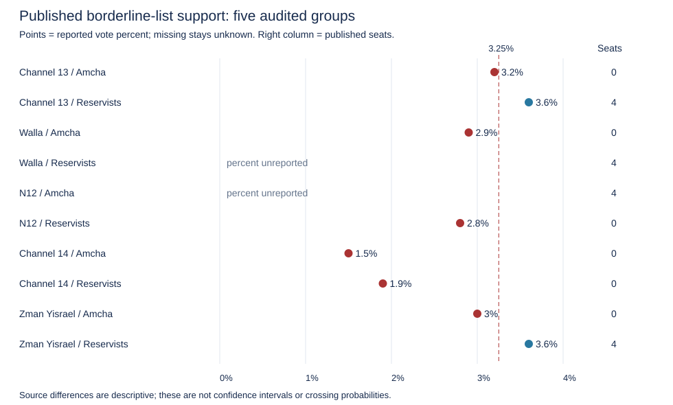

# Current poll audit - October 23

Research update; neither column is a selected final forecast.

Four new original releases replace older anchors; October 20 Walla remains the fifth group. A newer Maariv release is a known collection gap.

The two references still sum to 120 after rounding and pass every configured turnout/field check. Exact vectors, continuous means, changes from October 21, omission sensitivity and hashes are in baseline.json; source links and both seat tables are in summary.md.

| Party | Continuous mean | Rounded mean | L1 consensus | Mean change since Oct 21 |
| --- | ---: | ---: | ---: | ---: |
| Likud | 21.60 | 22 | 19 | +0 |
| Yashar! (Eisenkot) | 21.80 | 22 | 22 | -1 |
| Beyachad / Together (Bennett) | 13.00 | 13 | 14 | +0 |
| The Democrats | 8.80 | 9 | 9 | +0 |
| Yisrael Beiteinu | 7.60 | 8 | 8 | +0 |
| Shas | 8.00 | 8 | 8 | +0 |
| United Torah Judaism | 7.60 | 8 | 8 | +1 |
| Otzma Yehudit | 7.60 | 8 | 8 | +1 |
| Religious Zionism | 6.60 | 6 | 6 | -1 |
| Ra'am | 5.60 | 5 | 6 | +0 |
| Hadash-Ta'al | 8.60 | 8 | 9 | +0 |
| Blue and White | 0.00 | 0 | 0 | +0 |
| Amcha Yisrael | 0.80 | 1 | 0 | +0 |
| Reservists-Economic | 2.40 | 2 | 3 | +0 |
| Other parties passing the electoral threshold (combined seats) | 0.00 | 0 | 0 | +0 |

Amcha has seats in one selected release; Reservists in three. This frequency is not a calibrated election probability. Missing percentages stay null even when a complete table implies zero seats. Main-lineup observations are kept separate from N12's hypothetical withdrawal scenarios.

Averaging a zero-seat and a four-seat poll can produce one, two or three seats. That is an arithmetic point estimate, not proof of an attainable allocation. L0 feature regularization does not resolve this discontinuity. With partial percentages and no calibrated joint vote-share error model, forcing threshold outcomes now would add an unvalidated assumption.

Keep both references and the published measurements. Complete the final-source/official-lineup audit before choosing a submission vector; then assess any explicit threshold scenario adjustment against historical absolute seat error. No wider model sweep is justified by this update.

Official pages returned 403/geographic restriction; indexed CEC/Knesset text supports 3.25%, but current list eligibility, withdrawal notice, full allocator/agreements and operative blackout rules remain unverified. The competition PDF's Friday cutoff is retained as a document statement.
