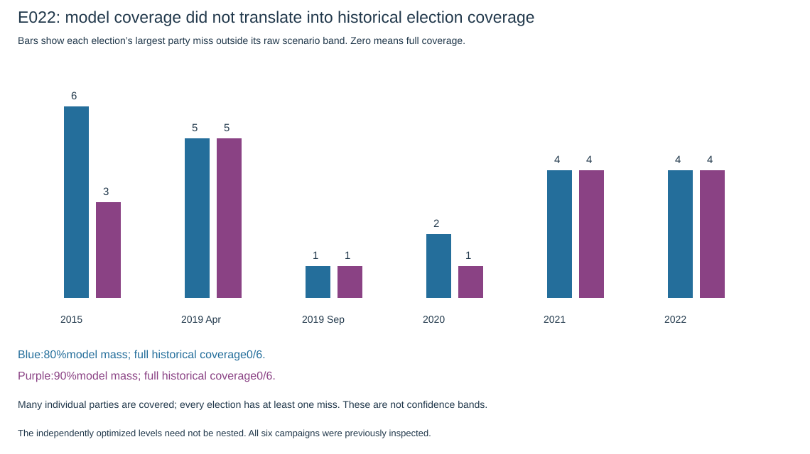
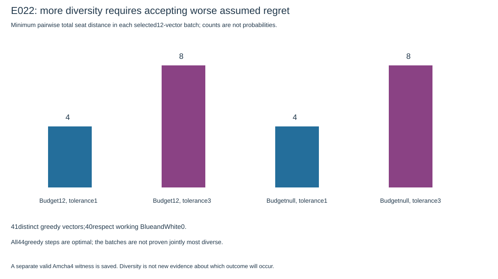

# E022: more alternatives, but narrow model bands are not calibrated confidence

Run [40317447939](https://github.com/Omer-Sut/israel-election-forecast/actions/runs/40317447939) succeeded at producer headbb58956956cc4c8c1d87478d2a5241e37f16cec7. Six tests, independent E021source audit and frozen-baseline reproduction passed. Research took12.485seconds. All14minimum-width primary problems and all14secondary centering problems were optimal; all44greedy diversity steps were optimal. These are finite prescribed problems, not an exhaustive model of real-world uncertainty. No forecast changed.

## 1. Model coverage did not become election coverage

| Nominal scenario target | Mean total band width, six elections | Actual complete elections covered | Mean marginal party coverage | Mean marginal interval-score sum | Poll-envelope score |
|---|---:|---:|---:|---:|---:|
|80%|30.50|0/6|63.93%|137.17|148.17|
|90%|35.00|0/6|62.89%|221.67|281.50|

The optimizer met its mathematical target: each assumed E021model placed at least80%or90%of its joint scenario mass inside the chosen band region. But every actual historical election had at least one party outside it. This is **0/6 whole-vector coverage**, not a statement that no individual party was predicted within bounds. Marginal coverage in the table averages each election equally; party rows are not independent calibration elections.

There is a positive diagnostic: interval scores improve on the raw poll-disagreement envelope on average at both levels. That means the bands strike a better width/miss tradeoff than that descriptive envelope under this auxiliary marginal score. It does **not** establish the claimed nominal joint coverage or a new point-forecast improvement. The optimizer targeted joint scenario mass; the reported score sums univariate interval scores, not a proper joint-region score. The six already-inspected dependent campaigns do not provide a fresh validation set or a significance claim.

Examples show the missing uncertainty:

- April2019NewRight's90%model band was5–6seats; actual0. Zehut was4–6; actual0.
-2021BlueandWhite was3–4; actual8. Several other2021lists also lay outside their bands.
-2022Meretz was4–5; actual0; Shas was8–9; actual11.

The constructed uncertainty family does not capture all shared polling errors, election-wide shifts or unanimous-but-wrong threshold projections. Optimizing its bands cannot repair uncertainty absent from the family. These results invalidate a calibrated-confidence interpretation of the bands, not the arithmetic of the optimization or automatically the adopted point forecast.

The80/90levels were independently optimized and were not constrained to be nested. Five historical90%boxes fail to contain their80%counterparts coordinate by coordinate; the current boxes are nested. That explains why larger nominal coverage can have slightly lower marginal historical coverage. A future uncertainty system would need an explicit nesting policy; none is retroactively introduced here.

## 2. Past-only expansion restores limited coverage by becoming very wide

The80%earlier-campaign rank diagnostic adds six seats on each side where the legal domain permits. It covers the complete2021and2022results, the only two historical targets with enough earlier campaigns for a finite80%rank. Widths become178and181. Two successes do not validate an80%coverage guarantee; the procedure uses dependent, previously inspected campaigns and unverified exchangeability.

For the current election:

| Region | Sum of coordinate widths | Feasible vectors under the coded roster/seat constraints |
|---|---:|---:|
|Raw80%scenario band|47|861,308|
|Raw90%scenario band|50|1,046,573|
|Earlier-history expanded80%diagnostic|187|27,719,586,369,766|

These are counts, not probabilities. Width totals need not equal120; every vector counted must itself sum120 and have no1/2-seat lists. Marginal endpoints cannot be combined freely. The expanded region includes Reservists0–10andAmcha0–10, intersected with allowed individual values0or>=3. It is honest about the weak precision of this simple diagnostic, but not a useful narrow guarantee.

For90%, the required rank with six earlier elections is7. No finite correction is reported by this procedure. This is a limitation of the specified finite-sample diagnostic, not proof that every possible90%prediction method is impossible.

Both raw current scenario bands allow each of Reservists and Amcha to have0,3or4seats. The point forecast Amcha0 is therefore compatible with positive-seat scenarios; it never meant zero probability of qualification.

## 3. Diversity finds more options, without estimating their chances

| Regret tolerance | Selected per batch | Minimum pairwise total seat distance | Focus outcomes among selected examples |
|---|---:|---:|---|
|1|12|4|Reservists3/4,Amcha0|
|3|12|8|Examples include Reservists0,3,4andAmcha0,3; both at3appears in the unrestricted batch|

Both budget12and unrestricted were run, yielding48batch entries and41distinct greedy vectors. Every added vector was a certified farthest point relative to that batch's previously selected set. This is not proof of a globally most-diverse12-vector batch. Increasing tolerance deliberately permits worse model regret. Distance4means two seats moved between parties; distance8means four moved. Counts/frequencies do not estimate election probabilities.

The finite greedy samples omit some feasible choices. For example, the original E021certified conditional Reservists0/Amcha4vector satisfies budget12and the wider tolerance3, with extra regret2.9196. The independent audit recomputes this witness and saves it alongside the candidates; its absence from the12-vector batches is not evidence of impossibility. Full coordinates are in audit.json and review-candidates.csv.

**Roster caveat:** one greedy vector assigns BlueandWhite3, contrary to our working withdrawal assumption. The original search deliberately did not impose a newly verified official hard zero because lineup authentication remains incomplete. That vector obeys the relaxed mathematical constraints but is not a submission-ready candidate. The review CSV flags it. Forty of the41distinct greedy vectors respect working BlueandWhite0. Excluding the flagged vector is a review filter, not a reoptimized or newly certified diversity batch. Original outputs are preserved. Other current qualifiers remain0as a roster assumption; full current vote-based Bader–Ofer attainability and form/official mapping are still unverified.

## Decision

The bandwidth proposal produced useful evidence about uncertainty and the diversity search produced more mathematical alternatives. Neither supplies a validated reason to select a different competition point forecast. Retain the adopted total120/no1–2seats vector, **Reservists3,Amcha0,turnout69.86%**. Do not describe the raw regions as calibrated confidence bands or choose a point from the candidate table by intuition alone.

Next concrete work is final source/form/lineup review and the submission review package. No automatic forecast adoption, merge or competition submission occurred.

## Provenance and audit

Artifact12647606917(diversity-bands-E022) is available until2026-11-25; API-reported ZIP digest39d95a4c0df1a17cf43e9c4d09a65dd4d90c513b39ad7e84458ec1ae6c21138f. Full E022results and E021checkpoint stay artifact-only. Compact independent audit, input hashes, plots and flagged review candidates are committed. The audit recomputes scenario coverage using rational weights, bounds/region counts, historical scores, strictly earlier calibration IDs/ranks, inflation, candidate feasibility/regret and greedy distance certificates. It also verifies the unchanged adopted-export SHA2563a02e8c53ef2b85af839b6d048650c4a581ad64e6a24cae0bd9c316ab449ca97.

Direct local transfer remained network-blocked; read-only helper40317867091retrieved the existing artifact without rerunning either experiment. Final PR37records published head and exact reference-reproduction/baseline checks. PR37stacks onPR36; live main remains49c9534and local Git metadata remains protected/stale3055db4. User hands-on effort is unmeasured.

To reproduce the audit after extracting the original E022and E021artifacts into their documented output folders:

    node scripts/analyze_diversity_bands.mjs output/diversity-bands-2026-10-26 output/numerical-search-2026-10-26 output/e022-analysis
