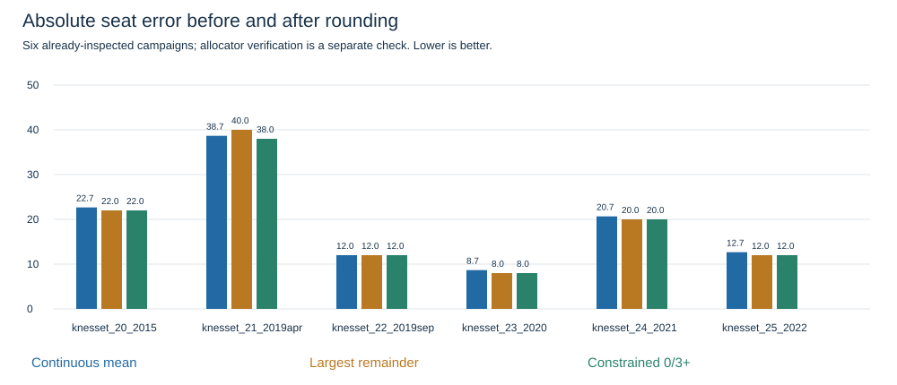

# Electoral allocation and rounding — October 24, 2026

E011 supersedes the E010 submission draft. No competition entry submitted.

The active draft minimizes squared distance to the seven-group mean over integer vectors summing to120, with each list either zero or at least3 seats. The secondary tie-break is absolute poll disagreement, then configured field order. This is an interim seat-space decision, not an exact current Bader–Ofer allocation. It enforces the user’s requested rule without inventing vote shares.

**Changes:** Amcha1→0; Reservists2→3. Other entries and turnout70.63% remain unchanged. Three seats are permitted by the statutory initial quota; four is common but is not a universal legal minimum. No new model was fitted.

**Vote allocator:** inclusive3.25% of all valid votes, integer initial quota, separate qualification before surplus pooling, highest quotients for remaining seats, pair-internal redistribution and the section81(d)(4) half-seat safeguard. Equal highest quotients raise an unresolved-lottery error. Complete 2022 votes reproduce all40 official list allocations exactly using the four historically reported agreements. This validates calculation on observed votes; it does not measure forecast accuracy.

**Current limitation:** the reviewed current releases have complete seat tables but partial vote percentages. An exact current vote-to-seat result cannot be identified. Zero published seats do not mean zero support. Complete shares for every individual list and verified current agreements remain necessary. The code refuses incomplete vote totals; other qualifying lists must be allocated individually before aggregation.

## Why rounding changes error

Old rounding was largest remainder: floor every mean, then award the unallocated seats to the largest fractional parts (ties by field order). This guarantees120 but ignores thresholds and agreements. It is not Bader–Ofer.

The competition loss is L1 = sum |prediction−truth|. Rounding minimizes neither future L1 error nor an unknown outcome. Fractional predictions lie in a larger decision space and small changes can cross integer boundaries. Rounding can help or hurt. With truth(61,59), forecast(60.6,59.4) has error0.8 and rounds to error0; forecast(60.4,59.6) has error1.2 and rounds to error2. Integer vectors both totaling120 have even total absolute error.

These retrospective comparisons use already-inspected elections, not a new holdout. Continuous scores remain useful diagnostics; only constrained integer outputs are active drafts.

| Election | Continuous L1 | Largest remainder | Active 0/3+ constraint |
| --- | ---: | ---: | ---: |
| knesset_20_2015 | 22.667 | 22 | 22 |
| knesset_21_2019apr | 38.667 | 40 | 38 |
| knesset_22_2019sep | 12.000 | 12 | 12 |
| knesset_23_2020 | 8.667 | 8 | 8 |
| knesset_24_2021 | 20.667 | 20 | 20 |
| knesset_25_2022 | 12.667 | 12 | 12 |

## Sources and limits

- [Knesset allocation explanation](https://main.knesset.gov.il/EN/About/Lexicon/pages/seats.aspx), retrieved indexed text October24,2026: threshold, quota and surplus method.
- [CEC 2021 law book](https://www.gov.il/BlobFolder/generalpage/elections-law24/he/candidates-list_disqualification_full-law-book.pdf), sections81–82: integer quota, lottery, half-seat safeguard and paired redistribution. Indexed primary text; full operative2026 consolidation remains unverified.
- [2022 agreement report](https://www.mako.co.il/news-israel-elections/election_2022/Article-aef85a44fc8f381026.htm): Likud/RZ, YeshAtid/NationalUnity, Shas/UTJ, Labor/Meretz. Meretz fails independently. Agreement fixture is news-reported, not a retrieved official agreement notice.
- Official2022 votes and final seats: versioned complete CEC national rows in data/database/official_lists.jsonl.gz; retained original source provenance. No historical forecasts consume these votes.
- Kan23/Channel16 source gaps and current official inventory/rules/agreements verification remain open. This package is provisional.
