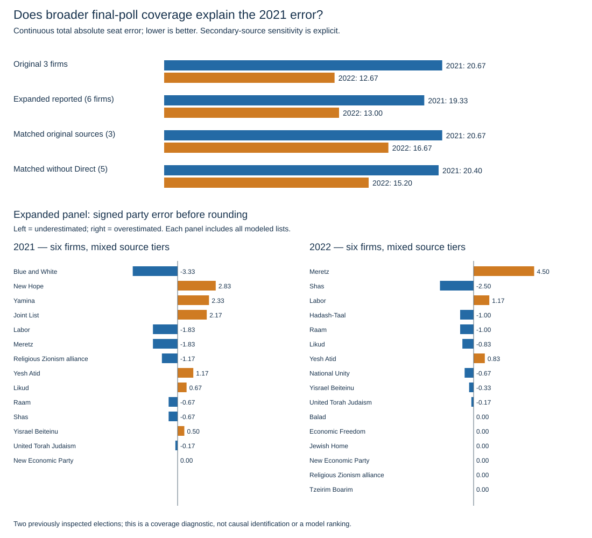

# Final-poll coverage sensitivity (E009)

Source-tiered retrospective comparison; outcomes already inspected. No model fitting, forecast selection or promotion of secondary records into training. Lower total absolute seat error is better.

| Panel | Firms 2021 / 2022 | Continuous error 2021 / 2022 | Integer error 2021 / 2022 |
| --- | --- | --- | --- |
| original_three | 3 / 3 | 20.667 / 12.667 | 20 / 12 |
| original_publisher_only | 3 / 4 | 20.667 / 13.000 | 20 / 12 |
| original_plus_republication | 3 / 5 | 20.667 / 12.800 | 20 / 12 |
| expanded_reported | 6 / 6 | 19.333 / 13.000 | 20 / 14 |
| matched_original_publishers | 3 / 3 | 20.667 / 16.667 | 20 / 18 |
| matched_reported | 6 / 6 | 19.333 / 13.000 | 20 / 14 |
| matched_without_direct | 5 / 5 | 20.400 / 15.200 | 20 / 14 |

Population variance describes the small set of final-poll errors, not calibrated uncertainty. Equal polling-firm weights; latest eligible publication per firm. Common firms do not guarantee unchanged methodology.

Smith remains excluded: incomplete retrieved primary2021 allocation, final2022 publisher source unverified. Direct2021 may include trend adjustment; matched_without_direct removes Direct in both years. No proof that remaining errors are caused by late movement rather than polling bias.

