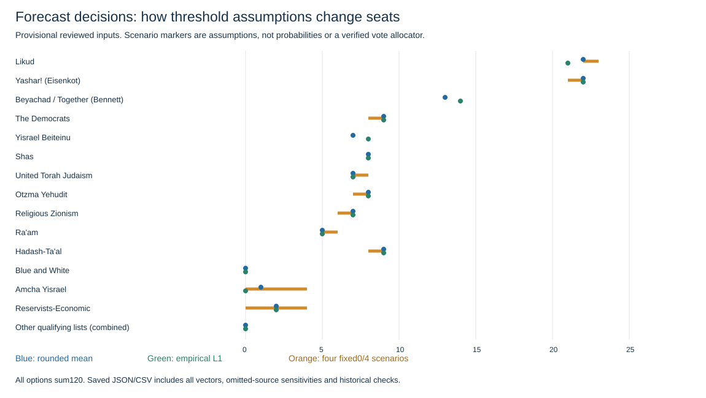

# Forecast review — October 24

Seven reviewed polling groups. Recommended reference is provisional: source freeze and official inventory verification remain incomplete. No competition entry submitted.

| Form field | Mean before rounding | Rounded mean | Empirical L1 | Zero-or-4 square sensitivity |
| --- | ---: | ---: | ---: | ---: |
| Likud | 22.429 | 22 | 21 | 23 |
| Yashar! (Eisenkot) | 21.857 | 22 | 22 | 22 |
| Beyachad / Together (Bennett) | 13.143 | 13 | 14 | 13 |
| The Democrats | 8.857 | 9 | 9 | 9 |
| Yisrael Beiteinu | 7.286 | 7 | 8 | 7 |
| Shas | 8.000 | 8 | 8 | 8 |
| United Torah Judaism | 7.429 | 7 | 7 | 8 |
| Otzma Yehudit | 7.857 | 8 | 8 | 8 |
| Religious Zionism | 6.571 | 7 | 7 | 7 |
| Ra'am | 5.429 | 5 | 5 | 6 |
| Hadash-Ta'al | 8.857 | 9 | 9 | 9 |
| Blue and White | 0.000 | 0 | 0 | 0 |
| Amcha Yisrael | 0.571 | 1 | 0 | 0 |
| Reservists-Economic | 1.714 | 2 | 2 | 0 |
| Other parties passing the electoral threshold (combined seats) | 0.000 | 0 | 0 | 0 |

Turnout persistence: **70.63%**. Every exported option sums120 and satisfies configured fields/turnout bounds.

## Retrospective threshold check

Already-inspected elections; these comparisons cannot provide a fresh model ranking. Minimum3/4 sensitivities are explicit assumptions, not verified electoral allocation.

| Election | Rounded mean | L1 | Square 0/3+ | Square 0/4+ | L1 0/3+ | L1 0/4+ |
| --- | ---: | ---: | ---: | ---: | ---: | ---: |
| knesset_20_2015 | 22 | 22 | 22 | 22 | 22 | 22 |
| knesset_21_2019apr | 40 | 40 | 38 | 38 | 38 | 38 |
| knesset_22_2019sep | 12 | 14 | 12 | 14 | 14 | 14 |
| knesset_23_2020 | 8 | 8 | 8 | 8 | 8 | 8 |
| knesset_24_2021 | 20 | 20 | 20 | 20 | 20 | 20 |
| knesset_25_2022 | 12 | 12 | 12 | 12 | 12 | 12 |

## Sources

- 2026-10-23 [Channel13 / HaMadad consortium](https://13tv.co.il/item/news/politics/politics/survey-905415900/); c13_consortium
- 2026-10-23 [i24NEWS / Direct Polls](https://www.i24news.tv/he/news/israel-elections-2026/polls/artc-07d162ea); direct_polls_sharon
- 2026-10-22 [Israel Hayom / Kantar](https://www.israelhayom.co.il/news/politics/article/21687549); kantar
- 2026-10-23 [Maariv via Walla](https://www.walla.co.il/news/israel/383958572); lazar_panel4all
- 2026-10-23 [N12 / Midgam](https://www.mako.co.il/news-israel-elections/2026/Article-8ea5e45ec2961a1027.htm); midgam_rc
- 2026-10-22 [Channel 14](https://www.c14.co.il/article/1750553); next_data
- 2026-10-22 [Zman Yisrael](https://www.zman.co.il/735649/); tatika_adgenda

## Remaining limitations

- Kan final Democrats8/9 source conflict; original final page unavailable. Channel16 original graphic unverified. Sensitivities are saved separately and not adopted.
- Israel Hayom and Kan share Kantar: a later verified Kan release would replace the Kantar anchor, not add a polling firm.
- Next Data/Filber and Direct Polls/Sharon are separate current reporting groups with common lineage; independence is not assumed. Omission sensitivities show both.
- Blue and White full withdrawal is reported by news quoting CEC. Official notice remains inaccessible; all selected complete polls already allocate zero. Keep its form field.
- Existing accepted Joint List and Religious Zionism alliance mappings are retained assumptions. Full official inventory, agreements, operative blackout text and allocator remain unverified.
- Partial vote percentages cannot reconstruct full vote shares. No probabilities assigned to the four threshold scenarios. Other-list thresholds must never be applied to pooled votes.
- Turnout intentions vary by question and denominator; they are not directly substituted for national turnout.
- Small positive seats in the reference summarize poll disagreement; they are not a simulated feasible election. No unvalidated threshold correction selected.
