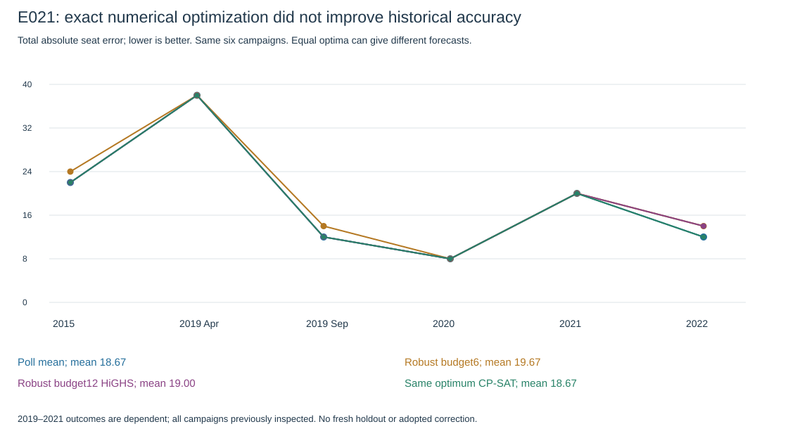
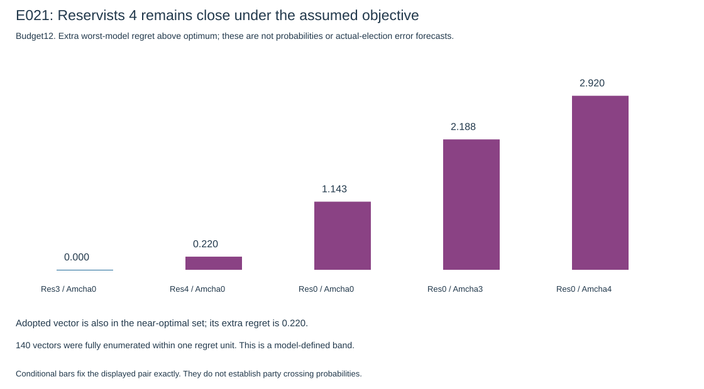

# E021: complete solver search, no demonstrated forecast improvement

Run [40311428283](https://github.com/Omer-Sut/israel-election-forecast/actions/runs/40311428283) completed successfully at producer head3d5d3190fc3616ed2049b07ac9ef74d5a63c2c4f. Eight validation tests, frozen-baseline reproduction and the adopted-export gate passed. The search itself took **47.176 seconds**, not three hours: the configured three-hour search-job limit was a ceiling, not requested artificial runtime.

This was a complete solve of the prescribed finite scenario-model experiment. It was not an exhaustive search of all possible real-world uncertainties. More time on these already certified optimization problems would not improve their objective values. All six historical campaigns had already been inspected; none is a new untouched holdout.

## Computation succeeded

The saved results contain267model-specific oracle optimizations and21robust optimizations (seven cases, three budgets). Every HiGHS result is optimal with zero reported gap and matching primal/lower bound. CP-SAT independently certified the same objective in nine checks. A separate standard-library Node audit recomputes all saved objectives from rational weights, checks every forecast/budget/total and compares the independent certificates. No new model fit or solver rerun is required for that audit. See audit.json and scripts/analyze_numerical_search.mjs.

Twenty-three current conditional0/3/4 cases are optimal and four are infeasible under the tight budget6. Those four are mathematical budget exclusions, not evidence that the parties cannot qualify. All27conditionals are feasible/certified or explicitly infeasible; none timed out. The current near-optimal enumeration also finished without hitting its200-vector cap:143vectors for budget6,140for budget12 and140unrestricted. These are full enumerations only inside their specified one-regret-unit bands and constraints; counts are not probabilities.

## Historical prediction did not improve

| Campaign | Constrained mean | Robust budget6, HiGHS | Robust budget12/unrestricted, HiGHS | Equally optimal budget12, CP-SAT |
|---|---:|---:|---:|---:|
|2015|22|24|22|22|
|2019 April|38|38|38|38|
|2019 September|12|14|12|12|
|2020|8|8|8|8|
|2021|20|20|20|20|
|2022|12|14|14|12|
|**Mean total seat error**|**18.67**|**19.67**|**19.00**|**18.67**|

Lower is better. The empirical-L1 control averages19.00. Equal-period errors are17.83for the mean and18.50for HiGHS budget12; the tighter-budget robust vector scores19.33. Report all campaigns and avoid choosing a method from a hindsight minimum. On the common recent four campaigns, the mean scores13.0 and the HiGHS budget12vector13.5; the larger six-campaign means above include the harder2015/April2019cases and are not contradictory metrics.

**Equal objective does not imply a unique forecast.** HiGHS and CP-SAT choose different equally optimal budget12vectors in2015,September2019 and2022. Their first two differences have the same actual error; in2022HiGHS transfers a seat from Likud to Meretz and scores14, whereas an equally optimal CP-SAT allocation scores12. Thus the numerical objective does not uniquely establish even the reported0.33-seat mean deterioration: another certified optimum ties the baseline. Neither certified selection beats it. Do not add a hindsight tie rule and describe it as independently validated skill.

## What the current alternatives say

All three current robust optima retain **Reservists3/Amcha0**. Budget6has two equal optima: move one seat from Likud to Together, or from Likud to YisraelBeiteinu. HiGHS returned the Together version. Budget12and unrestricted share one optimum: move one seat from ReligiousZionism to YisraelBeiteinu. Every other coordinate stays at the adopted reference. Those small changes are not adopted because the historical test does not establish an improvement.

For budget12/unrestricted, the best worst-model regret is1.4464. The adopted reference has1.6667, only0.2202higher. The best conditional Reservists4/Amcha0vector also has1.6667; Reservists0/Amcha0has2.5893. These are expected-L1 regret scores under constructed scenario distributions, not actual-election errors or calibrated crossing probabilities. They show that **four seats remains close under these assumptions**, rather than proving the three-seat point is uniquely correct in reality.

All140vectors in the budget12one-unit band have Amcha0 and Reservists3or4; the adopted reference is included. The band is defined by a chosen regret tolerance and finite models, not a confidence interval. Changing uncertainty assumptions can change it. The counts for each threshold choice must not be converted into passage probabilities. Near-optimal coordinate ranges are coupled; do not combine their endpoints as an independent valid forecast.

Budget6and budget12regret scores should not be ranked as if their numerical objective were identical: each subtracts different budget-constrained model optima. A wider budget can increase model regret because the oracle comparator improves. This is not a solver failure.

## Decision and limits

**Keep the adopted forecast unchanged.** Retain these alternatives as a sensitivity review, not a new selected model. Current numerical stability strengthens the case that another optimizer alone will not resolve the threshold question; it does not validate the subjective scenario weights, the0/3positive-seat restriction as a complete allocator, or the actual eventual result.

The models use empirical/leave-one-firm-out polls, explicitly assumed threshold mixtures and balanced±3/±6seat stresses. They do not fit historical covariance or provide a complete vote-based Bader–Ofer simulation. General threshold/allocator rules, official candidate/form mappings, complete current vote shares and operative agreement documentation remain distinct issues. Current is T−3/seven firms; history is T−1/three firms. Other current qualifiers are fixed0as a roster assumption. BlueandWhite0 was not imposed as newly verified law.

The active forecast stays total120, no1/2seat outputs, turnout69.86%, Reservists3, Amcha0. Its SHA256 remains3a02e8c53ef2b85af839b6d048650c4a581ad64e6a24cae0bd9c316ab449ca97. No competition submission, automatic adoption or merge.

## Durable evidence and reproduction

Compact source summary, input hashes, audit and both plots are committed here. Full checkpoint/scenario detail remains in artifact12645121746, numerical-search-E021, available until2026-11-25. Its API-reported ZIP digest is sha256:9f958c4cd1562b31f4ed4a70111bfc34c4ff3d871c7d4c448c2735a7c2338a2c. Checkpoint/postprocessor hashes and the actual executed commit are in audit.json. Raw detail can also be regenerated from versioned source inputs/code; equally optimal chosen vectors need not be identical across solver environments.

Direct local artifact transfer was network-blocked. Read-only helper run40312130309 retrieved the existing artifact and exposed lossless evidence through job logs; it did not rerun scientific computation. The final PR35record identifies the analysis-reference checks and published head. PR35stacks on PR34; local Git metadata remains protected/stale at3055db4. User hands-on effort remains unmeasured.

After downloading/extracting the original artifact into output/numerical-search-2026-10-26, reproduce the independent audit with:

    node scripts/analyze_numerical_search.mjs output/numerical-search-2026-10-26 output/e021-analysis

The next concrete step is final source/form review and the submission package; these solvers provide no reason to replace the working forecast. Submission still requires explicit user authorization.
