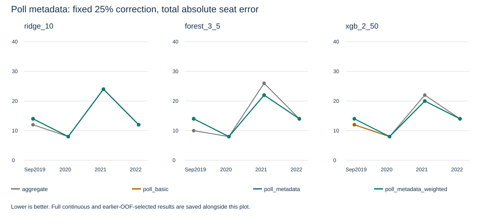

# E008: poll metadata now enters model training

Completed October 23; report publication resumed October 24 after a usage-limit interruption. The experiment implements the user's intended purpose: learn from individual polls using who conducted them and available methodology, with an additional test of reliability-weighted training. No current forecast or final method is changed.

## What changed

The original learner consumes aggregate poll features. Three controlled alternatives retain individual poll-party rows: seats/zero/lead time only; those inputs plus metadata; and metadata plus training reliability weights. Keeping the poll-basic control lets us distinguish the effect of retaining individual polls from the effect of their metadata. Target forecasts still average the latest polling groups equally.

Metadata includes pollster, publisher separately, actual sample size, reported mode, fieldwork duration/publication lag, explicit missingness and training-only category encodings. Pollster-by-seat-size interactions allow size-dependent corrections without pretending that historical party identities are interchangeable. Sampling design, effective sample size, panel provider, likely-voter screening and undecided rules remain unavailable for fitting; we did not infer them from publisher names.

There are 27 audited releases across six campaigns: sample size known for 22, mode for 11, fieldwork duration for 13. Seven early releases receive neutral reliability weights because fewer than two earlier campaigns exist. The remaining weights are estimated from strictly earlier campaigns. Multipliers actually range from 0.889 to 1.121 before campaign normalization; their declared allowed range is 0.75 to 1.5. Each campaign has equal total training mass, with firm/release/party balancing to limit repeated-observation dominance.

## What the results say

The plot shows fixed 25% correction. The uncorrected mean's integer errors across these four elections are 12, 8, 20 and 12. Lower is better; the main 2021/2022 comparison outcomes have already been inspected.

| Fixed 25% learner | Aggregate inputs: 2021 / 2022 | Poll-basic: 2021 / 2022 | Added metadata | Added training weights |
|---|---:|---:|---:|---:|
| Ridge | 24 / 12 | 24 / 12 | 24 / 12 | 24 / 12 |
| Random forest | 26 / 14 | 22 / 14 | 22 / 14 | 22 / 14 |
| XGBoost | 22 / 14 | 20 / 14 | 20 / 14 | 20 / 14 |
| Uncorrected mean reference | 20 / 12 | 20 / 12 | 20 / 12 | 20 / 12 |

Retaining individual polls improves some 2021 scores relative to the aggregate learner. Adding the metadata and training weights produces no further integer improvement at 25%: all twelve metadata/weighted comparison vectors exactly equal the corresponding poll-basic vectors, not merely their scalar errors.

The continuous predictions do change. For example, Ridge's 2021 total absolute error moves from 22.376 (poll-basic) to 22.245 (metadata), and its 2022 error from 13.387 to 13.319. The respective mean-reference errors are 20.667 and 12.667. Forest and XGBoost metadata changes worsen 2021 continuous error while modestly improving 2022. Training weights have small mixed effects. This is a real feature experiment whose changes are too small to survive rounding at this strength, rather than evidence that identical features or predictions were accidentally reused.

Correction strengths 0/5/25/100% were also selected using at least two strictly earlier out-of-fold elections. For 2021, poll-basic selects zero for all three learners (error20); metadata and weighted metadata select 5% for Ridge (error22) and zero for the others (error20). Every representation selects zero for 2022 (error12). Thus the past-only choice does not earn adoption either. These results do not establish that poll metadata is universally unhelpful: the sample is small, methodology coverage is sparse, and two comparison elections are repeatedly inspected. No best hindsight cell is selected.

## Verification and decision

Implementation `66d76c33e5168399ef1adfee74d780bb75dd72c3`, [PR19](https://github.com/Omer-Sut/israel-election-forecast/pull/19), stacked on PR18. [Scientific run39952455330](https://github.com/Omer-Sut/israel-election-forecast/actions/runs/39952455330) passed all70 tests and identical E008 results/summary/plot repeats. [Baseline39952455404](https://github.com/Omer-Sut/israel-election-forecast/actions/runs/39952455404) passed with five optional scientific skips and preserved all frozen reports. E008 runtime1.190seconds; manifest's `1fb0fb97c7bd97c27943fa739113e6fcc0a1c3c5` is the tested PR merge ref, not an actual PR merge. All48 aggregate-control scores independently match E006's saved original-feature results (continuous tolerance1e-8, exact integer equality).

The artifact [12499774990](https://github.com/Omer-Sut/israel-election-forecast/actions/runs/39952455330/artifacts/12499774990) was verified available,105815bytes, expiring November22. Four exact public text outputs were recovered from hosted encoded logs; no binary archive hash verification is claimed. `results.json` preserves192 score rows,48 chronological selections, all per-party vectors, per-poll weights, metadata coverage and training vocabularies. `manifest.json` preserves code/source hashes. See [generated summary](summary.md) for the complete fixed/selected table and [protocol](../../docs/poll-metadata-trial.md) for assumptions.

Keep the poll-level metadata and leakage-safe weighting machinery for further evidence. Do not adopt the learned correction or weights into the current forecast. If this research continues, prioritize audited methodological coverage across historical campaigns before another parameter sweep. Final current-source/lineup completeness and the threshold decision remain separate forecasting priorities. No turnout adjustment, merge or competition submission occurred. User cumulative hands-on effort remains unmeasured; the budget has not been reset.

## E008 cross-run verification follow-up — October 24

Report commit033ef260 passed baseline40066365528; scientific40066365525 passed model tests and exact same-run repeats but failed committed JSON byte comparison. All integer allocations/errors, selected fractions, summary and plot match. Of289 numerical differences, all above1e-10 are weighted-forest continuous outputs, maximum0.016915 seats. No model configuration or saved reference changed. Cross-run comparison now allows absolute0.02 seats only for weighted-forest continuous predictions/errors and1e-10 for other floats; discrete values and structure remain exact. This tolerance was set after observing the discrepancy and is not evidence of bitwise reproducibility. Three comparator regression tests added; hosted rerun pending. No correction adopted; user cumulative effort remains unmeasured.
