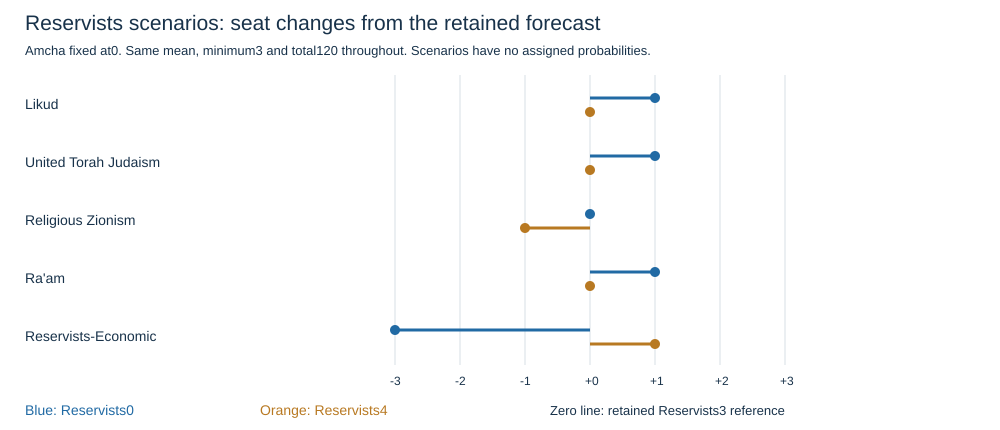

# Forecast review package — October 24, 2026

**Working reference retained: Reservists3, Amcha0; total120; turnout70.63%.**
This freezes the review artifact, not a claim that source collection is complete. No competition entry submitted.

## Full forecast and conditional alternatives

The middle column is the selected working reference. Alternatives hold Amcha, Blue and White and other qualifying lists at zero; every remaining list follows the same zero-or-at-least3 rule. Only the Reservists assumption changes. Each alternative minimizes squared distance to the same poll mean and reallocates seats to maintain120. These are seat-space comparisons, not Bader–Ofer simulations or assigned probabilities.

| Form field | Reservists0 | Reference: Reservists3 | Reservists4 |
| --- | ---: | ---: | ---: |
| Likud | 23 | 22 | 22 |
| Yashar! (Eisenkot) | 22 | 22 | 22 |
| Beyachad / Together (Bennett) | 13 | 13 | 13 |
| The Democrats | 9 | 9 | 9 |
| Yisrael Beiteinu | 7 | 7 | 7 |
| Shas | 8 | 8 | 8 |
| United Torah Judaism | 8 | 7 | 7 |
| Otzma Yehudit | 8 | 8 | 8 |
| Religious Zionism | 7 | 7 | 6 |
| Ra'am | 6 | 5 | 5 |
| Hadash-Ta'al | 9 | 9 | 9 |
| Blue and White | 0 | 0 | 0 |
| Amcha Yisrael | 0 | 0 | 0 |
| Reservists-Economic | 0 | 3 | 4 |
| Other parties passing the electoral threshold (combined seats) | 0 | 0 | 0 |
| **Total** | **120** | **120** | **120** |

National turnout in every option: **70.63%**. This is the last-official-election persistence estimate, not a conversion from poll voting intentions.

## Which parties change?

- Reservists0 versus reference: Likud +1, United Torah Judaism +1, Ra'am +1, Reservists-Economic -3.
- Reservists4 versus reference: Religious Zionism -1, Reservists-Economic +1.

## Decision and explanation

Retain the reference rule already adopted after the user excluded1/2-seat outputs. No new model was fitted and no scenario was selected using hindsight historical gains. Reservists3 is a constrained compromise between polls giving0or4. It is not a claim that3is the most likely outcome. A zero-or-4 rule would be an additional modeling restriction, not a verified universal legal requirement.

The decision solves min sum_i (s_i−mean_i)^2 subject to sum_i s_i=120 and s_i in {0,3,4,...,120}. Absolute disagreement with the selected polls breaks objective ties, followed by configured field order. This is a transparent way to enforce the requested output rule; competition evaluation remains total absolute seat error against the eventual result.

The old largest-remainder method floored the means and assigned remaining seats by fractional parts. It maintained120 but could produce1/2 seats. See the [before/after rounding analysis](../electoral-review-2026-10-24/analysis.md) and [plot](../electoral-review-2026-10-24/rounding-error.svg). Continuous scores are diagnostics; they do not certify a feasible final election.

## Sources and remaining limits

The [seven-release review](../forecast-review-2026-10-24/summary.md) records publisher links and selection. The [vote-input audit](../vote-input-audit-2026-10-24/analysis.md) records the bounded attempt to recover complete shares. The [allocator verification](../electoral-review-2026-10-24/analysis.md) reproduces2022 seats from official votes; it does not validate a current forecast.

- Complete current vote shares and their denominator are missing.
- Current surplus agreements are news-reported, not verified official filings.
- Kan23 Democrats8/9 conflict and Channel16 original-source gap remain excluded.
- Current Joint List and Religious Zionism form mappings remain explicit assumptions.
- Reservists3 is a constrained compromise; selected polls report0or4, not3.
- Historical outcomes have been inspected; no untouched validation or calibrated probabilities.
- Form decimal increments, personal details, track/team and presentation agreement are not completed here.

## Review artifacts

- forecast.json: exact copy of the retained draft, with provisional flags.
- scenario-comparison.csv and package.json: complete vectors, signed changes, assumptions and input identities.
- method-description.txt: actual implemented method, below500words.
- validation.json and inputs-manifest.json: arithmetic/contract checks and hashes.
- No personal information, presentation consent or competition submission is included.
