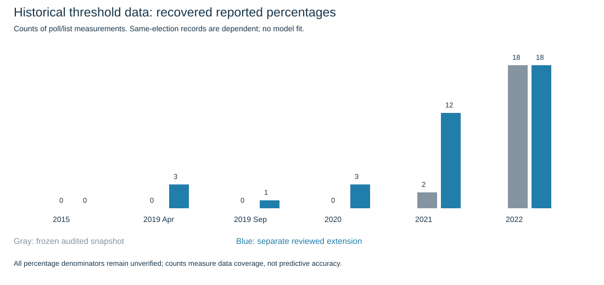

# E019: extended historical threshold evidence

Keep audited overlay; no automatic training promotion, model fit or forecast change.

Audited releases: 24 → 32. Exact reported percentage observations: 20 → 37. These are repeated poll/list measurements, not independent election outcomes.

| Campaign | Releases before/after | Exact percentages before/after | Eventual passes/fails* |
|---|---:|---:|---:|
| knesset_20_2015 | 3/3 | 0/0 | 0/0 |
| knesset_21_2019apr | 3/4 | 0/3 | 1/2 |
| knesset_22_2019sep | 3/4 | 0/1 | 0/1 |
| knesset_23_2020 | 3/5 | 0/3 | 0/3 |
| knesset_24_2021 | 6/10 | 2/12 | 6/6 |
| knesset_25_2022 | 6/6 | 18/18 | 0/18 |

*Among exact reported-share observations: 7 later-pass records and 30 later-fail records, covering 12 unique election/list outcomes (3 that passed). Repeated releases share the same result.

## What improved

Eight complete original-publisher releases add trajectories and another firm in April2019; two existing releases gain explicit percentages. We now retain Raam–Balad2019Apr and Raam/Meretz2021 examples with below-threshold published support that later won seats. The original exact-percentage subset contained only eventual failures. This corrects a training-data coverage limitation, not a forecast error by itself.

Source publication, fieldwork and known revision dates are separate. Discovery includes final28publication days; horizon bands1–7,8–14,15–28 and the original T−1 effective-age gate are exported separately. Never pool these as matched final-week observations.

## Quality limits and gates

The reported percentage denominator and allocation of undecided voters remain unverified. None is certified directly comparable to valid-vote share. No shares are normalized, inferred from seats or assigned numerical lower bounds from positive seat projections. Missing values stay blank/null, never zero. Retrospective source versions are not authenticated historical archives.

The two Walla2020 releases print identicalFeb16–17fieldwork,N502/invited3486 despite different publication dates/results. A wave-linkage warning is retained; these cannot be counted as independent samples. N12 and Walla share Midgam, while MakoMorningApril2019 uses PanelsPolitics; commissioner and firm are separate fields.

2015 still lacks recovered numerical shares in the reviewed original articles. New2021percentage coverage is concentrated in one polling firm. One Maan2021percentage is retained in unmapped.json pending an official identity check and is excluded from outcome-linked counts. No full current vote vector or new current forecast is supplied.

A blocked official2022PDF is only a discovery lead in source-audit.json, not admitted data. Secondary contradictory tables and earlier-wave comparison figures are not silently copied.

observations.csv includes evaluation labels; predictor-records.json is an explicit pre-election whitelist and excludes outcomes. Any later learner must use earlier campaigns only and preserve campaign/firm/release dependence. The export is a separate overlay; all frozen model inputs and adopted69.86%turnout/seat forecast remain unchanged.

