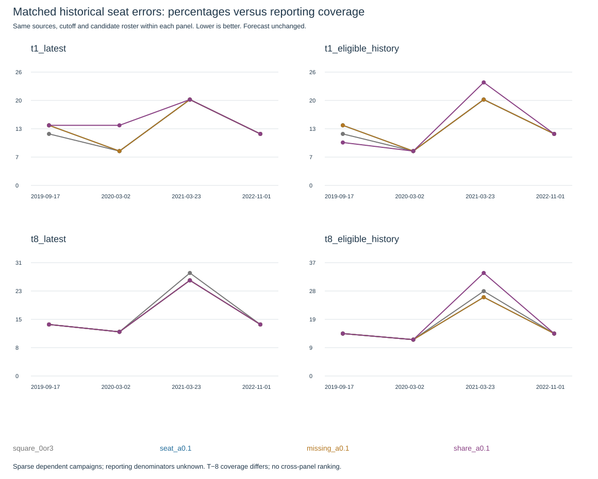
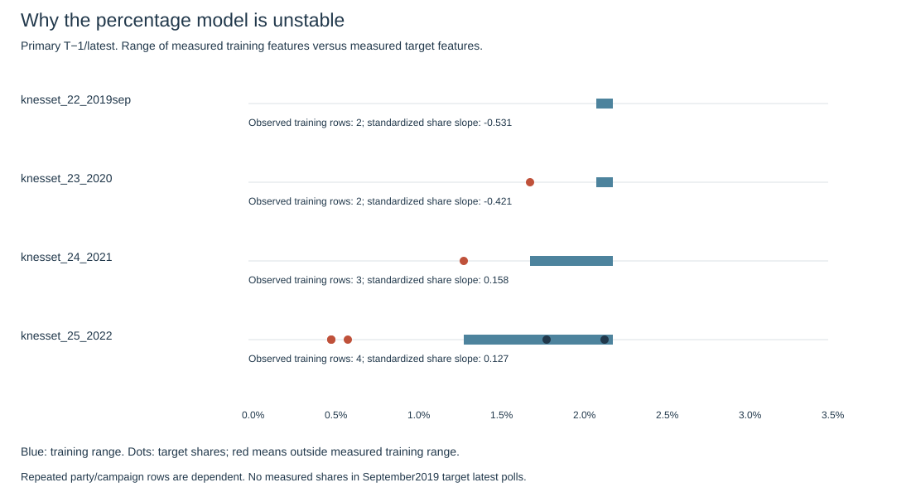

# E020: percentages did not earn a forecast change

The user authorized a matched comparison after E019 expanded the historical source data. The primary trial uses identical latest-firm seat vectors, candidate lists, T−1 cutoff and fourteen-day effective-age window in all arms. Reporting coverage and then reported percentages are added separately. Training uses earlier campaigns only, equal campaign mass and training-only imputation/scaling. No frozen data, adopted model, seat vector or69.86% turnout changed.

## Primary result

Lower total absolute seat error is better. Four learned evaluation campaigns are September2019,2020,2021,2022;2015/April2019 warm up fitting. The expanded candidate population yields20 probability predictions across these four campaigns, not20 independent elections. Earlier inspected campaigns are not an untouched holdout.

| Method | Sep2019 |2020|2021|2022| Mean seat error | Mean campaign Brier |
|---|---:|---:|---:|---:|---:|---:|
| Constrained poll mean |12|8|20|12|13.0|—|
| Seat-only learner, penalty0.1 |14|8|20|12|13.5|0.0722|
| Seats plus reporting coverage |14|8|20|12|13.5|0.0691|
| Seats, coverage and percentage |14|14|20|12|15.0|0.3204|

The percentage feature worsens the primary result. Reporting coverage slightly improves the numerical probability score but leaves every historical seat vector unchanged relative to the matched seat-only learner. That small dependent-sample change is not a demonstrated useful forecast improvement. Brier is the average squared difference between the numerical representation forecast and the eventual0/1 outcome, first within each campaign then across campaigns; it is a different loss from the competition's total absolute seat error.

## Why the percentages can mislead this fit

In the early primary training campaigns the only measured candidate shares are the pooled Raam–Balad2019Apr value2.1% (eventually passed) and Gesher2.2% (failed). A logistic regression with an unconstrained slope can learn that lower reported percentages predict passing. This is an unstable association from sparse selectively reported measurements, not evidence that lower support helps a party qualify. Warm-up2015has no measured percentage to anchor that slope.

For the2020primary evaluation, the model encounters Otzma at1.7%, outside that tiny measured training range, and outputs p≈0.99865 despite its eventual failure. Its total seat error rises from8to14. The percentage slope later changes sign as more campaigns arrive. This is a concrete failure of this feature/fit design under sparse coverage; the source values remain retained and the no-future-training tests pass. It does not establish that percentages in general are useless.

Missing percentages are never treated as zero support. The model imputes their feature from observed training values and includes reporting coverage separately. Even so, the available numerical shares mostly describe excluded lists; positive seat projections usually lack exact percentages. Reporting is informative and the historical/current measurement processes differ. Reported denominators and undecided allocation remain unverified. These records are not reconstructed valid-vote shares.

## Sensitivities and selection

Using older percentage releases still inside the same forecast window is explicitly separate from latest-poll values. At T−1, share penalty0.1 averages13.5 and wrongly excludes Raam2021, trading a2019Sep improvement for a2021loss. The stronger penalty1 averages12.5 versus13.0 for the constrained mean, but this is the best inspected sensitivity, a gain concentrated in one campaign. The selector using only earlier complete OOF campaign errors chooses the weaker share model before2021 and scores24there. Across four learned folds its mean is14.0, worse than13.0 for the constrained mean. The hindsight12.5 does not justify choosing that penalty now as an established improvement.

At T−8, most campaigns have only one eligible firm (2021has three); these are sparse source-matched diagnostics, not a full balanced national-poll panel. Latest-percentage arms tie the matched seat-only arm at16.5; history percentages at0.1 worsen it to18.5. Never interpret different panel averages as gains caused by a feature. Within each panel all arms use the same roster, firms and cutoff. Durable evaluation and selection outputs are in summary.json; the full generated fit/probability detail is supplementary in the hosted artifact and reproducible from versioned inputs/code.

Candidates include all-zero seat projections if the chosen panel has an observed percentage. Conditional positive support for these lists is an explicit four-seat assumption, shared across arms. It is not an inferred vote share or a law. Joint expected-L1 decisions can retain zero even when a marginal p exceeds0.5 because allocating that list seats changes allocations elsewhere under total120. The output is a seat-space decision, not a complete Bader–Ofer scenario. All-zero lists with no percentage remain outside this learned roster. E018's smaller roster has a different Brier denominator and cannot be directly compared.

## Current focus and decision

On the unchanged seven audited latest releases, the matched seat-only learner outputs Reservists4/Amcha0; adding reporting coverage outputs0/0; adding percentages also outputs0/0. Primary percentage numerical probabilities are approximately0.259/0.180. These are exploratory estimates, not calibrated crossing probabilities. The current snapshot is T−3 rather than historical T−1, and changes in firm count/reporting coverage remain unresolved. They do not justify replacing the adopted Reservists3/Amcha0 reference.

**Keep the extended data and reproducible diagnostics; do not adopt this percentage learner or a new forecast.** The next useful data work is comparable original reported shares near the threshold on both sides, including qualifying-list percentages, with denominator/undecided and publication-vintage review. Another same-grid sweep would not address the observed narrow-support/selective-reporting failure. A monotonic support assumption could be a future explicitly evaluated modeling hypothesis, not an automatic repair or an implemented correction here.

## Execution and continuity

Implementation8a97b44 / PR32 stacked on PR31 passed dedicated40202667646 (six tests and deterministic repeats), baseline40202667583 and scientific40202667571. Added support/extrapolation diagnostics afterward without changing model fits or predictions; the final report-commit verification is recorded on [PR32](https://github.com/Omer-Sut/israel-election-forecast/pull/32). Protocol was committed before inspecting results. Inputs/code hashes, compact evaluation results, plots and findings are durable in Git. The full generated fit-detail file stays in the supplementary hosted artifact and can be regenerated; it is not committed. No random seed, no heavy training, user cumulative hands-on effort unmeasured. Local GitHEAD3055db4 is stale; use PR32's verified live topic head, not a blind local commit. No merge or submission.
