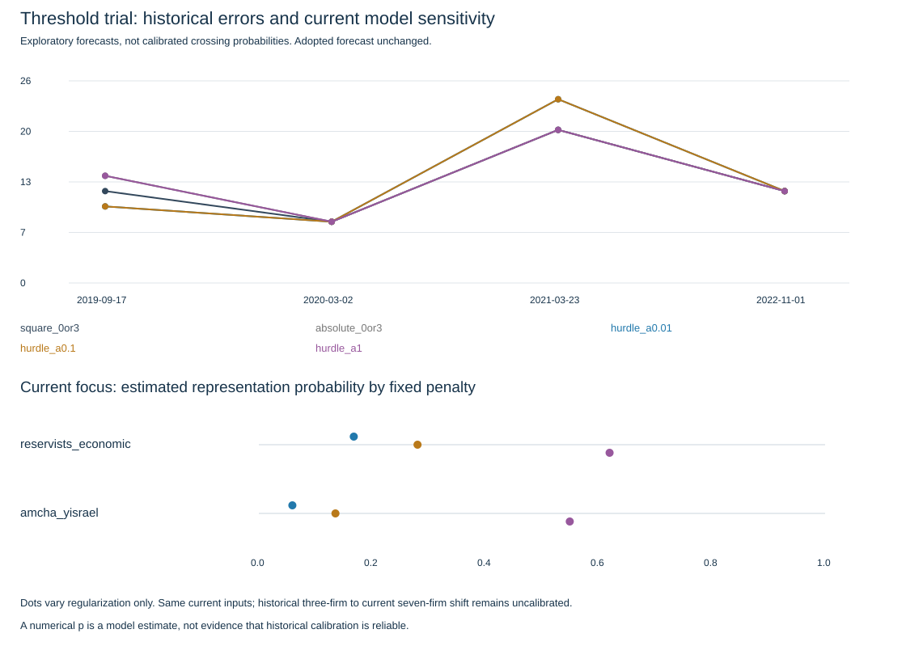

# E018: threshold-aware seat research

Research only; adopted forecast/turnout unchanged. No calibrated threshold probabilities claimed.

| Method | Four-fold mean seat error | Equal-period error | False positives | False negatives | Brier* |
|---|---:|---:|---:|---:|---:|
| square_0or3 | 13.000 | 12.667 | 2 | 0 | — |
| absolute_0or3 | 13.500 | 13.000 | 2 | 0 | — |
| hurdle_a0.01 | 13.500 | 13.000 | 1 | 1 | 0.166 |
| hurdle_a0.1 | 13.500 | 13.000 | 1 | 1 | 0.149 |
| hurdle_a1 | 13.500 | 13.000 | 2 | 0 | 0.151 |

*Brier averages each campaign equally over its modelled candidate lists; not all lists. Controls have no learned probability forecast. Lower is better.2019–21 is one period,2022 another;2015/April2019 warm up learning. No untouched holdout.

## Current focus: exploratory model outputs

| Method | Reservists seats | Model p(represented) | Amcha seats | Model p(represented) |
|---|---:|---:|---:|---:|
| square_0or3 | 3 | — | 0 | — |
| absolute_0or3 | 3 | — | 0 | — |
| hurdle_a0.01 | 0 | 0.168 | 0 | 0.059 |
| hurdle_a0.1 | 0 | 0.280 | 0 | 0.135 |
| hurdle_a1 | 4 | 0.619 | 0 | 0.549 |

Earlier-campaign selector: {'id': 'square_0or3', 'status': 'earlier_campaign_selection', 'validation_dates': ['2019-09-17', '2020-03-02', '2021-03-23', '2022-11-01']}

These numerical probability forecasts are not certified crossing probabilities. Poll pass frequency is an input, not a probability interpretation. Current source percentage evidence is retained separately in results.json with missing values and URLs. No new sources promoted.

## Limitations

- Six inspected campaigns, four learned outer folds; party rows are dependent.
- Training candidate roster requires at least one positive projection; all-zero lists are not modelled probabilities.
- Current has seven firms; history has three. Firm count/fraction precision shift is uncalibrated.
- Conditional positive support is a limited empirical poll distribution, not a complete seat scenario.
- Current below-threshold percentages are descriptive, not historical training features.
- Marginal expected-loss decision is not a feasible joint vote/allocation simulation.
