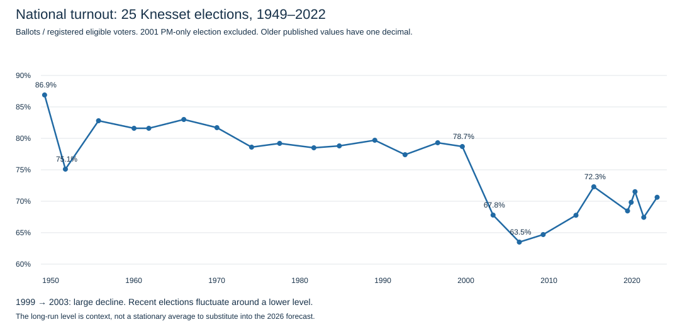
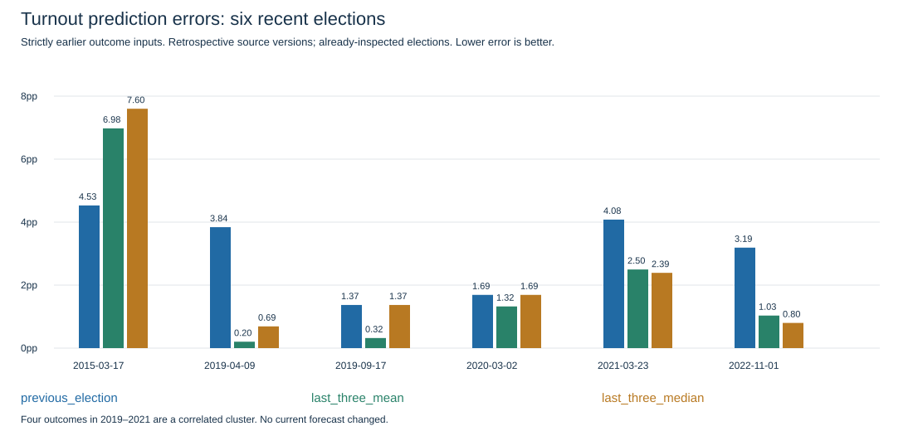

# Turnout: past-election analysis

**25 Knesset elections,1949–2022. The working forecast stays 70.63%.** This is the first systematic turnout check; earlier work only carried 2022 forward.2001 elected only a prime minister and is excluded.

Turnout means ballots cast divided by eligible registered voters, including invalid ballots in the numerator. Party percentages use valid votes, a different denominator. Preserve published precision: CBS older rows have one decimal; recent CEC percentages have two. Count-derived ratios are separate diagnostics.

Source check: retrieved CBS text gives 79.8% for 1984, while its own counts imply 78.7837%. The archived CEC row and IDI both give 78.8%, which is used explicitly in analysis; the original retrieved value is preserved. Whether the discrepancy is in rendering or source text remains unresolved. Other archived CEC inconsistencies for 1961/2003 are not imported: count-consistent CBS values are retained. See input source_conflicts.

## What changed historically?

- 1949–1999: 15 elections, mean 80.19%, sample SD 2.82 percentage points.
- 2003–2022: 10 elections, mean 68.39%, sample SD 2.82 percentage points.
- 2015–2022: 6 elections, mean 70.03%, sample SD 1.84 percentage points.

The low 2003–2006 period followed a large break from the pre-2000 period. Repeated elections did not produce a monotone decline: turnout rose in September 2019 and March 2020, then fell in 2021 and rose in 2022. Election fatigue alone is not an established forecast rule. Pandemic, participation composition, competition and election spacing are possible explanations; none is isolated causally here.

## Does the previous election predict the next one?

For each election t, use only elections before t: previous=T(t−1); mean 3=(T(t−1)+T(t−2)+T(t−3))/3; median 3=median of those three. Loss is absolute error in percentage points. No fitted coefficients, parameter search or future outcomes enter these predictors. The common comparison begins at K 4 after three warm-up elections. Retrospective source versions are used; original historical releases were not reconstructed.

| Election | Actual | Previous prediction / error | Mean 3 prediction / error | Median 3 prediction / error |
| --- | ---: | ---: | ---: | ---: |
| 2015-03-17 | 72.30% | 67.77% / 4.53 | 65.32% / 6.98 | 64.70% / 7.60 |
| 2019-04-09 | 68.46% | 72.30% / 3.84 | 68.26% / 0.20 | 67.77% / 0.69 |
| 2019-09-17 | 69.83% | 68.46% / 1.37 | 69.51% / 0.32 | 68.46% / 1.37 |
| 2020-03-02 | 71.52% | 69.83% / 1.69 | 70.20% / 1.32 | 69.83% / 1.69 |
| 2021-03-23 | 67.44% | 71.52% / 4.08 | 69.94% / 2.50 | 69.83% / 2.39 |
| 2022-11-01 | 70.63% | 67.44% / 3.19 | 69.60% / 1.03 | 69.83% / 0.80 |

| Method | Recent six MAE | Three-block sensitivity MAE | All 22 common folds MAE |
| --- | ---: | ---: | ---: |
| previous_election | 3.117 | 3.488 | 2.385 |
| last_three_mean | 2.059 | 3.032 | 2.530 |
| last_three_median | 2.423 | 3.312 | 2.700 |

The block sensitivity gives equal weight to 2015, the 2019–2021 cluster and 2022; it does not manufacture independent observations. The smoothing methods may improve an aggregate score while badly missing 2015. These are already-inspected elections and a small recent sample, so the table is evidence to discuss, not an automatic model-selection certificate.

## Conflict context: does war imply higher turnout?

A curated core uses six named wars and assigns the first election following each onset (which may occur while fighting continues). A sensitivity adds four specified Gaza operations. Multiple events pointing to one election are counted once.1949 has no previous election and cannot contribute a change. Event dates/provenance and all window rules are in the input JSON. This is exploratory, not a preregistered or exhaustive conflict dataset. Onset is not an end date; neither ongoing conflict nor time since war end is measured.

| Definition | Elections with a change | Mean change after onset | Mean other change |
| --- | ---: | ---: | ---: |
| six_named_wars | 5 | -0.820 pp | -0.641 pp |
| wars_plus_four_operations | 8 | +0.836 pp | -1.435 pp |

Definition sensitivity is itself a limitation: wars, operations, era and turnout trends are mixed. No significance test or causal coefficient is reported, and no war bonus/penalty is added to 2026.

| First election | Included events | Turnout change |
| --- | --- | ---: |
| 1949-01-25 | independence | No earlier election |
| 1959-11-03 | sinai | -1.20 pp |
| 1969-10-28 | six_day | -1.30 pp |
| 1973-12-31 | yom_kippur | -3.10 pp |
| 1984-07-23 | lebanon_1 | +0.30 pp |
| 2009-02-10 | lebanon_2, cast_lead | +1.20 pp |
| 2013-01-22 | pillar | +3.07 pp |
| 2015-03-17 | protective_edge | +4.53 pp |
| 2022-11-01 | guardian | +3.19 pp |

365/730/1095-day onset windows are saved separately in results.json, with election IDs and sample sizes. The collection omits the intifadas, War of Attrition and other operations: none of its comparisons establishes how an ongoing 2026 conflict would affect turnout. The WHO pandemic characterization on March 11,2020 followed the March 2 election;2021 followed that declaration. This does not mean COVID was absent before March 11 or that the 2021 decline was caused by COVID.

## What do turnout polls tell us?

The existing six-election panel contains 24 release rows but only 2 numeric turnout-intention observations, both from one election. Missing observations stay missing. Two releases are not two independent election targets. Original 2021 final N 12/C 13 articles were checked, without recovering a comparable national numeric measure.

| Release | Reported voting intention | Actual national turnout | Intention minus actual |
| --- | ---: | ---: | ---: |
| [2022-10-24](https://www.mako.co.il/news-israel-elections/2022_q4/Article-989f30b39aa0481027.htm) | 69.00% | 70.63% | -1.63 pp |
| [2022-10-28](https://www.mako.co.il/news-israel-elections/election_2022/Article-afc48a535be1481026.htm) | 67.00% | 70.63% | -3.63 pp |

The 2022 intentions undershot actual turnout. Do not assume a universal upward self-report bias or subtract one fixed number from current surveys. TheOctober 24 wording reports intention to vote; October 28 asks whether the respondent would come if the election were today. Current definitely-vote questions and different populations/denominators need their own audit. No poll-to-turnout calibration is fitted from this one election.

## Implication for the current forecast

- previous_election: 70.63%; within configured form bounds: True.
- last_three_mean: 69.86%; within configured form bounds: True.
- last_three_median: 70.63%; within configured form bounds: True.

Keep 70.63% as the working placeholder for now. A recent mean is a concrete lightweight alternative to discuss, with the observed 2015 failure and small-sample caveats. This analysis does not overwrite the frozen review package, seats, turnout or method text. No current war, economic or demographic adjustment has been adopted. The next useful turnout work is comparable historical intention-question coverage and carefully defined participation groups, rather than a broad model search.

## Sources and reproducibility

- [CBS table 27.2](https://www.cbs.gov.il/he/publications/DocLib/2022/ShnatonElectionsTheKnessetandGovernment.27/st27_02.pdf), published August 2,2022: heading 1949–2022, rows actually stop at March 2021.2022 is appended separately from [CEC final results](https://votes25.bechirot.gov.il/nationalresults).
- Existing versioned CEC national totals supply recent exact percentages; [Knesset official reference](https://main.knesset.gov.il/EN/activity/mmm/me03504.pdf) corroborates 2013 turnout 67.77%. Raw count ratios and published values are both retained.
- Primary IDF/Ministry of Defense event URLs are stored individually in the input. Only onset facts are used, not their political interpretations. [WHO dated report](https://www.who.int/docs/default-source/coronaviruse/situation-REPORTS/20200311-SITREP-51-COVID-19.PDF) supplies the pandemic characterization date.
- Run `python scripts/turnout_history.py`. Input data: data/snapshots/turnout-history-2026-10-24/inputs.json. Historical-vintage limits and omitted events are explicit. No raw PDF/page checksum is invented; the manifest hashes versioned inputs and code.
