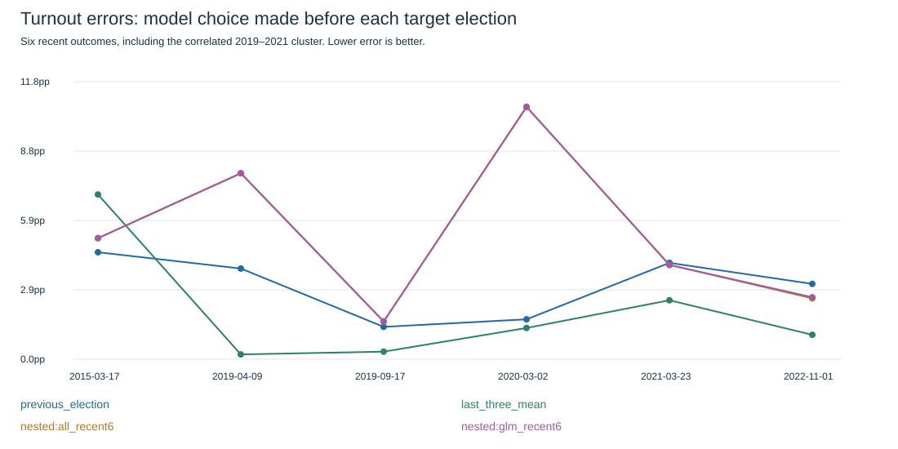
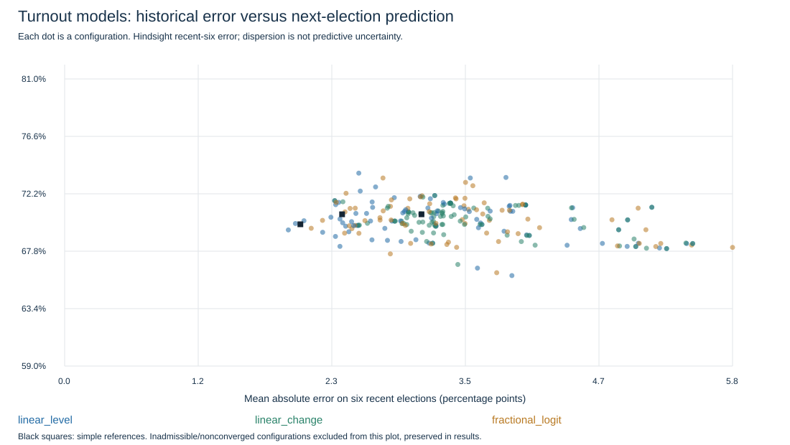

# Turnout regression and GLM time-series screen

**264 fitted configurations; no current forecast change adopted.** All estimates are national turnout percentages; errors are percentage points.

## What was fitted?

Eight feature sets cover AR1/AR3 lags, changes, three-election means, election gaps, annualized momentum, expanding means and a calendar/post2000 sensitivity. Three fitting windows use all earlier lag-complete elections, the last12 or last8. Linear models predict either the level or the change from the previous election, with ridge alpha0/.01/.1/1; fractional-logit GLMs use alpha.001/.01/.1. Every training row and feature uses only earlier election outcomes. Scaling is fitted on the training rows, and intercepts are not penalized.

Linear objective: mean((y−Xb)^2)/2 + alpha*||slopes||²/2, with y=T/100 or the turnout change/100. The latter is a regularized correction around previous turnout. Fractional-logit objective: mean(log(1+exp(Xb))−(T/100)*Xb) + alpha*||slopes||²/2; prediction=100*sigmoid(Xb). Each election has equal weight. This is fractional-response quasi-likelihood, not a binomial experiment with millions of independent voters; no naive voter-count standard errors are reported.

Coefficients, training IDs, training means/scales, optimizer status and feature values are saved. Unconstrained out-of-range estimates remain visible; they are excluded from point-selection eligibility using the configured inclusive40–100 bounds, never silently clipped. Nonconverged fits are also excluded.

## Chronological model selection

Six earlier lag-complete rows are required to fit a candidate:16 common outer elections from1981–2022. At each target, choose the configuration using only its previously completed out-of-fold errors, either the last6 or all earlier folds. At least3 earlier folds are required; initial selector folds use previous-election persistence. References remain in every selection pool so the selector can decline a regression. Current admissibility is checked before selection. Ties rounded at8 decimal places favor references, then a fixed ID. No target truth is supplied to selection.

| Past-only rule/reference | Recent six MAE | All16 MAE | Three-block MAE | Next estimate |
| --- | ---: | ---: | ---: | ---: |
| previous_election | 3.117 | 2.804 | 3.488 | 70.63% |
| last_three_mean | 2.059 | 2.945 | 3.032 | 69.86% |
| last_three_median | 2.423 | 3.194 | 3.312 | 70.63% |
| nested:all_recent6 | 5.310 | 4.183 | 4.581 | 69.43% |
| nested:all_expanding | 3.730 | 3.805 | 3.727 | 69.92% |
| nested:linear_recent6 | 2.885 | 3.357 | 2.334 | 69.43% |
| nested:glm_recent6 | 5.318 | 4.305 | 4.597 | 69.86% |

The block metric gives equal weight to2015, the2019–2021 cluster and2022. A good-looking fixed configuration ranked on these outcomes is a hindsight discovery; its score must not be confused with the past-only selectors above. These inspected data are not a fresh holdout.

## Hindsight ranking: descriptive, not selected forecasting skill

| Configuration | Recent MAE | All16 MAE | Recent worst | Next estimate |
| --- | ---: | ---: | ---: | ---: |
| linear_level__ar1__w8__a1 | 1.954 | 3.038 | 2.954 | 69.43% |
| linear_level__era_trend__wall__a1 | 2.016 | 2.300 | 3.743 | 69.92% |
| last_three_mean | 2.059 | 2.945 | 6.977 | 69.86% |
| linear_level__ar1__w12__a1 | 2.090 | 2.844 | 4.644 | 70.13% |
| fractional_logit__ar1__w8__a0.1 | 2.154 | 3.020 | 3.038 | 69.56% |
| fractional_logit__ar1__w12__a0.1 | 2.252 | 2.414 | 4.499 | 70.16% |
| linear_level__era_trend__w12__a1 | 2.254 | 2.395 | 4.299 | 69.25% |
| linear_level__era_trend__w8__a1 | 2.326 | 2.766 | 5.564 | 70.41% |
| linear_change__era_trend__w12__a0 | 2.359 | 2.513 | 6.296 | 71.67% |
| linear_level__era_trend__w12__a0 | 2.359 | 2.513 | 6.296 | 71.67% |
| linear_level__ar3__w8__a1 | 2.365 | 4.589 | 3.979 | 68.93% |
| linear_level__ar3__wall__a1 | 2.367 | 2.993 | 4.556 | 71.37% |

There are 240 distinct historical prediction vectors at7-decimal precision among 264 configurations. OLS on equivalent feature spans and some level/change parameterizations can coincide; this is expected algebra, not additional independent validation.

## What would the chronological selectors use now?

- all_recent6: 69.43%, selecting `linear_level__ar1__w8__a1` from earlier OOF elections [20, 21, 22, 23, 24, 25].
- all_expanding: 69.92%, selecting `linear_level__era_trend__wall__a1` from earlier OOF elections [10, 11, 12, 13, 14, 15, 16, 17, 18, 19, 20, 21, 22, 23, 24, 25].
- linear_recent6: 69.43%, selecting `linear_level__ar1__w8__a1` from earlier OOF elections [20, 21, 22, 23, 24, 25].
- glm_recent6: 69.86%, selecting `last_three_mean` from earlier OOF elections [20, 21, 22, 23, 24, 25].

The scatter shows sensitivity across configurations, not a confidence/prediction interval. A stable next estimate is not proof of accuracy. No automatic replacement of the70.63% working placeholder is made by a many-configuration screen; review the chronological errors and stability before adopting one.

## Limits

- Only25 outcomes and22 lag-complete rows, with16 outer evaluation elections.
- No untouched holdout: historical outcomes and the post2000 break were already inspected.
- Many configurations are equivalent or correlated; configuration count is not independent evidence.
- Four2019–2021 elections are correlated; block sensitivity reported separately.
- Retrospective source vintages; strictly earlier numerical outcomes, not certified real-time reconstruction.
- Fractional-logit quasi-likelihood treats elections equally; ballots are not independent model trials.
- Current war/poll-intention covariates omitted because comparable audited inputs are insufficient.

Source history and conflict/denominator caveats: [E014 analysis](../turnout-history-2026-10-24/analysis.md). The next-election date is the competition-provided2026-10-27, not a new independent election-date verification. No same-election turnout intentions or later outcomes enter fits.

Reproduce: install requirements-turnout.txt on a hosted CPU and run `python scripts/turnout_models.py`. NumPy/SciPy versions, all configuration outputs and input hashes are saved. No additional dependencies enter the standard-library baseline. The workflow compares numeric values within absolute1e-7, with exact configuration/selection identities and exact displayed plots/text.
